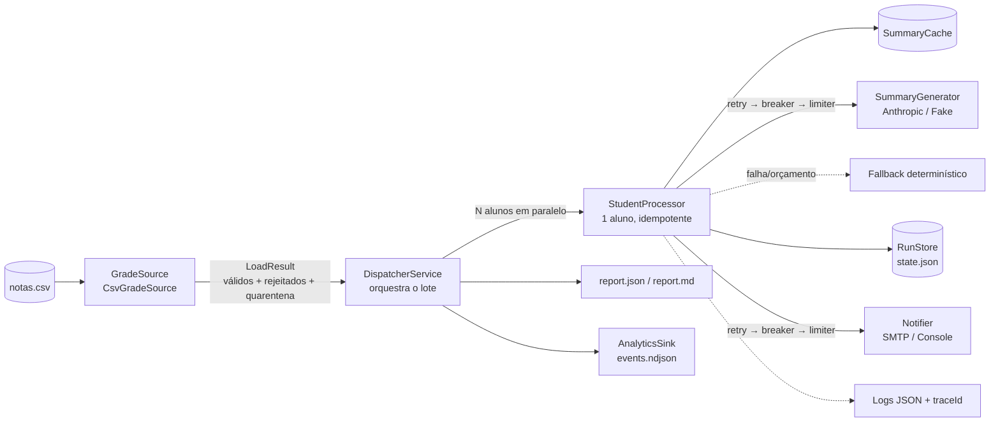
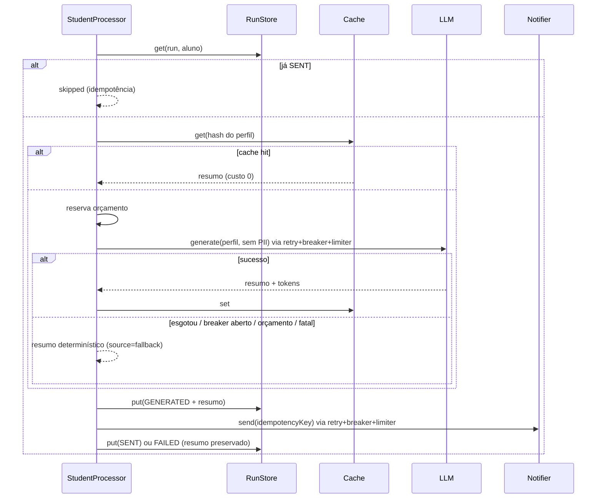
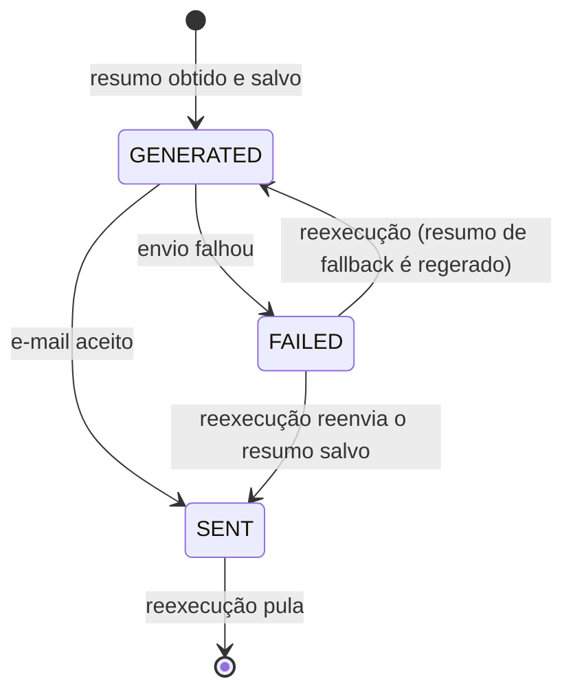

# Arquitetura

## Visão geral

Arquitetura hexagonal enxuta: o **pipeline não conhece LLM, SMTP nem armazenamento**; só conhece portas (`src/domain/ports.ts`). Os adaptadores são escolhidos no composition root (`src/app.module.ts`) por configuração.



## Fluxo de um aluno



## Máquina de estados por aluno



O resumo é gravado **antes** do envio, de modo que retentar um envio nunca paga o LLM duas vezes.

## Contratos (portas)

| Porta | Contrato | Adaptadores |
|---|---|---|
| `GradeSource` | `load(): LoadResult` (válidos, rejeitados sem PII, quarentena) | `CsvGradeSource` |
| `SummaryGenerator` | `generate(GradeProfile): {summary, usage, model}`; erros só `RetriableError`/`FatalError` | `AnthropicSummaryGenerator`, `FakeSummaryGenerator` |
| `Notifier` | `send(NotificationMessage)`; mesma classificação de erros | `SmtpNotifier`, `ConsoleNotifier` |
| `RunStore` | `get/put` por `(run, aluno)` | `JsonStateStore` |
| `SummaryCache` | `get/set` por hash de perfil | `JsonStateStore.asCache()` |
| `AnalyticsSink` | `track(evento)` | `FileAnalyticsSink` |

O **contrato de erro** é a parte central: cada adaptador traduz os erros do mundo externo (HTTP status, códigos SMTP) para `RetriableError` (vale repetir) ou `FatalError` (não vale). Quem repete (`withRetry`) e quem protege (`CircuitBreaker`) só enxerga essas duas classes. Há teste de contrato para `SummaryGenerator`.

## Camadas de proteção em cada chamada externa

```
withRetry ( CircuitBreaker ( RateLimiter ( chamada ) ) )
```

1. **Retry**: backoff exponencial com *full jitter*; `Retry-After` vira piso do atraso; só repete `RetriableError`.
2. **Circuit breaker**: abre após N falhas transitórias seguidas, falha rápido e testa com uma sonda após o cooldown. Erro fatal de dado não conta.
3. **Rate limiter**: espaça chamadas para respeitar o limite do provedor.
4. **Orçamento**: reserva o custo previsto *antes* de chamar o LLM; ao estourar, cai no fallback.

## Observabilidade

- **Logs estruturados** (pino, JSON): `runId`, `traceId`, `studentId`, `event`, durações. Redaction de `email`, `name`, `apiKey`, `pass`.
- **Tracing simulado**: `traceId` por execução e spans (`load_grades`, `process_students`) no formato OpenTelemetry.
- **Métricas** no relatório: latência média/p50/p95 por aluno, vazão, taxa de falha, tokens, custo, hits de cache, uso de fallback.
- **Analytics de produto**: `run_started`, `student_processed` (outcome/source/duração/custo), `student_failed` (kind), `run_completed` (taxa de falha, custo).

## Segurança

- **Minimização de PII**: o LLM recebe apenas notas e disciplinas (sem nome, e-mail ou matrícula); a chave de cache também não tem PII.
- **Entrada não confiável**: texto do CSV é sanitizado (controle, `<`/`>`, tamanho); no prompt os dados vão em bloco `<dados>` declarado como dados; a saída do modelo é validada por schema; o HTML do e-mail escapa tudo.
- **Segredos** só por ambiente, validados no boot (`zod`); `.env` ignorado pelo git.
- **Logs sem PII**; e-mail mascarado no notificador de console; relatório de linhas rejeitadas sem conteúdo da linha.
