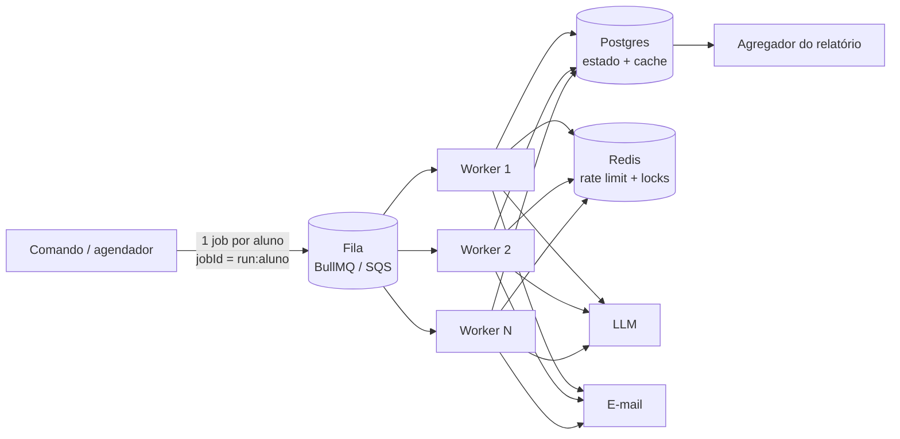

# Escala, custo e garantias

## 10 mil alunos/hora

10k/h ≈ **2,8 alunos/s**. O gargalo não é CPU: é a latência do LLM (~1–3 s) e os limites do provedor/SMTP.

Com concorrência 10 e ~2 s por aluno o processo atual já faz ~5/s, então **um único processo aguenta a carga média**. O que muda para ser *robusto* a esse volume e a picos (fim de período concentra tudo):

1. **Fila com um job por aluno.** `jobId = runId:studentId` já deduplica enfileiramento. O `StudentProcessor` é o handler como está: ele é *stateless* (todo estado está atrás de `RunStore`/`SummaryCache`).
2. **Workers horizontais** (autoscaling pelo tamanho da fila). Escalar workers não muda o código do pipeline.
3. **Estado no Postgres**: `(run_id, student_id)` único; cache de resumos por hash.
4. **Rate limit e breaker compartilhados** (token bucket no Redis; estado do breaker por dependência), senão N workers somam N× o limite do provedor.
5. **Backpressure**: concorrência por worker limitada e a fila absorve o pico; o provedor nunca vê mais que o limite global.
6. **Relatório por agregação** da tabela de estados ao fim da execução (hoje é feito em memória).
7. **Observabilidade**: tracing OTLP com `traceId` propagado no job; métricas de profundidade da fila, p95 e taxa de fallback; alerta quando `fallbackUsed` ou a taxa de falha passam do limiar.

## Exatamente-uma-vez

Entre dois sistemas independentes (nosso estado ↔ servidor de e-mail) não existe exatamente-uma-vez *puro*. O que se constrói é **efeito exatamente-uma-vez = entrega pelo menos uma vez + idempotência**:

| Camada | Mecanismo (✔ = implementado) |
|---|---|
| Enfileirar | `jobId = run:aluno` ✔ (desenho) |
| Processar | Chave `(run, aluno)` no estado; `SENT` é pulado ✔ |
| Gerar | Resumo salvo antes do envio: retomar não regasta LLM ✔ |
| Enviar | `Message-ID` determinístico `run:aluno` ✔: o destino/MTA deduplica reenvios |
| Janela `send → put(SENT)` | **Outbox transacional**: gravar a intenção de envio na mesma transação do estado e deixar um dispatcher entregar; reenvios continuam possíveis, mas deduplicáveis pelo `Message-ID` |
| Concorrência entre workers | **Claim atômico**: `UPDATE ... SET status='PROCESSING', lease_until=now()+X WHERE (run,aluno) AND status IN ('FAILED','GENERATED',NULL) RETURNING *`; lease expira se o worker morrer |

## Se o LLM custasse 10× mais

Ordem de ataque (da maior alavanca para a menor):

1. **Não chamar**: o cache por perfil já elimina repetição. Ampliar: arredondar para faixas (ex.: 0–9, 10–13, 14–16, 17–20) e agrupar por *combinação de estados* por disciplina. Resumo por **template** para perfis comuns, LLM só para os atípicos.
2. **Modelo menor / tiering**: Haiku → modelo ainda menor para o caso comum; modelo maior só para alunos em risco (onde a qualidade do texto importa).
3. **Batch API assíncrona** do provedor (desconto relevante em volume): boletim não é tempo real; aceita-se latência de horas.
4. **Prompt mais enxuto** e `max_tokens` menor (a saída custa mais por token que a entrada).
5. **Orçamento duro** (`MAX_RUN_COST_USD`): já implementado. Passa a ser a rede de segurança que degrada para fallback em vez de estourar o custo.
6. **Decidir com dados**: o relatório já mostra custo por aluno e % de cache/fallback; comparar a satisfação com texto LLM vs. template para ver se o LLM ainda se paga.

## API fora do ar: o que acontece

| Quem cai | Efeito | Recuperação |
|---|---|---|
| **LLM** | Retries com backoff; o breaker abre e os demais alunos falham rápido para o **fallback**; todos recebem boletim | Reexecutar o período: resumos de fallback são **regerados** pelo LLM |
| **SMTP** | Breaker de envio abre; alunos ficam `FAILED` com resumo preservado; exit code 1 | Reexecutar o período: só reenvia, custo de LLM zero |
| **Armazenamento** | Falha de escrita é fatal para o aluno (não se envia sem conseguir registrar) | Corrigir e reexecutar |
